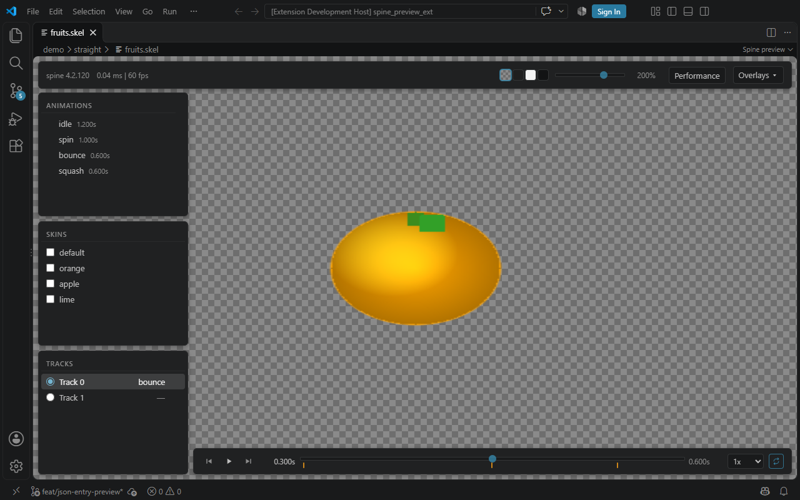

# spine animation preview for vscode



## usage

Open any `.atlas` file. Every Spine skeleton (`.json` or binary `.skel`) next to it is loaded and
listed in the dropdown, so one atlas can serve several skeletons.

Use Spine 4.2 exports to match the bundled runtime. JSON and binary skeletons
can share the same folder and atlas.

If a skeleton fails to load, it is marked `(failed)` in the dropdown. Select it
to see its error, or choose another skeleton to continue previewing. A missing
or broken shared atlas still prevents the whole preview from loading.

For a binary test scene, open `demo/straight/demo.atlas` and select `fruits.skel` or
`vegetables.skel`.

The status bar shows **PMA** when the selected skeleton uses premultiplied alpha.
Hover or focus the badge to see the affected texture pages. The same **PMA** badge
appears if any referenced page uses PMA, including mixed alpha formats. It stays visible in narrow
windows. This describes the atlas metadata, not an automatic analysis of pixels;
an omitted `pma` field is treated as false by the Spine runtime.
Only pages referenced by the selected skeleton's attachments are counted,
including all skins and sequence frames, regardless of the current pose.

Open `demo/pma/demo.atlas` for one atlas with a PMA page and a straight-alpha page:

- `pma.json` uses only `pma.png`: **PMA**. Normal disc on the left, Additive on the right.
- `straight.json` uses only `straight.png`: no PMA badge, with the same two discs.
- `mixed.json` uses both pages: **PMA**, with only `pma.png` listed in the tooltip.
  Left column PMA, right straight alpha; top row Normal, bottom row Additive.

Play `fade` to check soft edges and animated slot opacity. Corresponding discs
should look identical. Try Checkerboard, Dark and Light backgrounds.
The PMA PNG contains premultiplied RGB values, rather than only a changed flag.
Recreate both textures with `node utils/generate-pma-textures.mjs`.
See [utils](utils/README.md) for reusable development tools.

## panels

- Animations - click one to play it on the selected track, hover to list its events
- Skins - tick several at once to composite them
- Tracks - which track the next animation is set on
- Timeline - transport, scrubber, playback speed from 0.1x to 5x, and loop
- Event markers sit under the scrubber; click one to jump to it, and events
  authored on the same frame share a marker
- Fired events pop up above the timeline and flash the marker they came from
- Overlays - toggle bones, bone names, mesh wireframes, mesh hulls, region attachment outlines,
  clipping polygons, paths with control handles, bounding box attachments and the
  skeleton's local origin. Layers without matching geometry are disabled.
  Hide/show all layers without clearing their selection;
  selections carry over when switching skeletons. Close the panel with Escape
  or a click outside it. Bounding boxes are attachments exported from Spine,
  rather than the overall bounds of the artwork. Origin axes: red +X (right),
  green +Y (up).
  Bone names includes the same bone lines and joints as Bones, plus names that
  follow active joints and stay the same size when zooming.

Loop is independent for each track; the timeline button controls the selected
track. New and cleared tracks start with Loop enabled. Switching skeletons resets
these settings. Loop governs playback only: scrubbing and stepping stop on the
first and last frame rather than wrapping around.

Play/Pause, scrubbing and frame stepping affect only the selected track. Other
tracks keep their current playback state. Choosing an animation starts it on the
selected track without resuming paused tracks. Playback speed applies to all tracks.

Open Performance to collect actual WebGL draw calls per rendered frame, after
batching. The side panel shows the latest frame and the peak.
Opening the panel or switching skeletons starts a fresh measurement.
Close the panel with its close button, Performance, or Escape to stop collection
and remove the WebGL hooks. You can keep it open while using playback and overlays.
Visible overlays are included; use Hide overlays in the panel to measure the
animation alone. Values refresh four times per second, including while paused.
These are draw submissions, not attachment counts or GPU execution time.

Blend modes counts rendered slots in the current pose by Normal, Additive,
Multiply and Screen. Unused modes are omitted; hover or focus the values to see
slot names for non-normal modes. Fully transparent or clipped-away attachments
are excluded. These counts describe the skeleton, excluding debug overlays,
and are sampled only while Performance is open.

CPU update / frame measures the animation and skeleton pose update, excluding
overlays and rendering. It shows an exponentially smoothed time in milliseconds
and the highest single update since opening the panel or switching skeletons.
Paused frames still update the pose and are measured. Timing collection stops
when the panel is closed; this is CPU elapsed time, not GPU time or CPU usage percent.

## blend mode demo

Open `demo/straight/demo.atlas`, select `drawcall-stress.json`, then play `blend-modes-test`
on Track 0 with other tracks empty and Performance open. Each phase lasts one
second: Normal, Additive, Multiply, Screen, all four, then no rendered slots.
The six-second loop has named event markers for seeking. A light-gray Normal
attachment is drawn behind the samples inside the canvas so Multiply has an
opaque surface to blend with. It adds one Normal slot: the Normal phase shows
Normal 2, the other single-mode phases show Normal 1 plus that mode, and the
combined phase shows Normal 2 plus one of each other mode. The empty phase hides
the backdrop too and shows None. The CSS checkerboard is not a blending surface.
Hover Blend modes to check the `blend-additive`, `blend-multiply` and
`blend-screen` slot names. Switching back to `stress-100-drawcalls` restores the
original 100-tile test (50 Normal and 50 Screen).

## controls

- Mouse wheel - zoom towards the cursor (5% to 800%)
- Shift + left-click drag - pan the animation
- Middle-click drag - pan the animation
- Double-click the canvas - reset zoom and pan
- Right-click an animation - copy its name
- Space - play / pause
- Left / Right arrow - step one frame, forward reporting the events it crosses

## build

```bash
pnpm install
pnpm run pack
```

## vscode

```
Extensions -> install from VSIX -> repo folder
```

## install from vscode market

[vscode marketplace](https://marketplace.visualstudio.com/items?itemName=neymanushka.spine-animation-preview)
