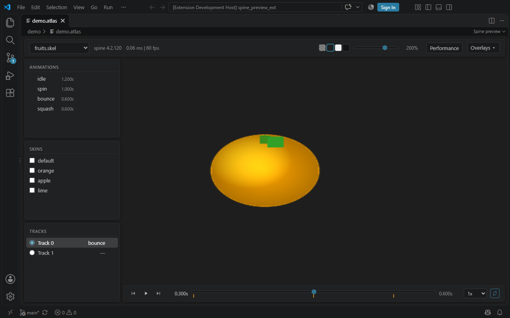

# spine animation preview for vscode



## usage

Open any `.atlas` file. Every Spine skeleton (`.json` or binary `.skel`) next to it is loaded and
listed in the dropdown, so one atlas can serve several skeletons.

Use Spine 4.2 exports to match the bundled runtime. JSON and binary skeletons
can share the same folder and atlas.

If a skeleton fails to load, it is marked `(failed)` in the dropdown. Select it
to see its error, or choose another skeleton to continue previewing. A missing
or broken shared atlas still prevents the whole preview from loading.

For a binary test scene, open `demo/demo.atlas` and select `fruits.skel` or
`vegetables.skel`.

## panels

- Animations - click one to play it on the selected track, hover to list its events
- Skins - tick several at once to composite them
- Tracks - which track the next animation is set on
- Timeline - transport, scrubber, playback speed from 0.1x to 5x, and loop
- Event markers sit under the scrubber; click one to jump to it, and events
  authored on the same frame share a marker
- Fired events pop up above the timeline and flash the marker they came from
- Overlays - toggle bones, bone names, mesh wireframes, mesh hulls, region attachment outlines,
  clipping polygons, paths with control handles, bounding box attachments and the
  skeleton's local origin. Layers without matching geometry are marked
  "None in this skeleton". Hide/show all layers without clearing their selection;
  selections carry over when switching skeletons. Close the panel with Escape
  or a click outside it. Bounding boxes are attachments exported from Spine,
  rather than the overall bounds of the artwork. Origin axes: red +X (right),
  green +Y (up).
  Bone names follow active joints and stay the same size when zooming; they can
  be enabled independently of bone lines.

Loop governs playback only: scrubbing and stepping stop on the first and last
frame rather than wrapping around.

Open Performance to collect actual WebGL draw calls per rendered frame, after
batching. The side panel shows the latest frame and the peak.
Opening the panel or switching skeletons starts a fresh measurement.
Close the panel with its close button, Performance, or Escape to stop collection
and remove the WebGL hooks. You can keep it open while using playback and overlays.
Visible overlays are included; use Hide overlays in the panel to measure the
animation alone. Values refresh four times per second, including while paused.
These are draw submissions, not attachment counts or GPU execution time.

## controls

- Mouse wheel - zoom towards the cursor (5% to 800%)
- Shift + left-click drag - pan the animation
- Middle-click drag - pan the animation
- Double-click the canvas - reset zoom and pan
- Right-click an animation - copy its name
- Space - play / pause
- Left / Right arrow - step one frame, forward reporting the events it crosses

## build

```bash
pnpm install
pnpm run pack
```

## vscode

```
Extensions -> install from VSIX -> repo folder
```

## install from vscode market

[vscode marketplace](https://marketplace.visualstudio.com/items?itemName=neymanushka.spine-animation-preview)
